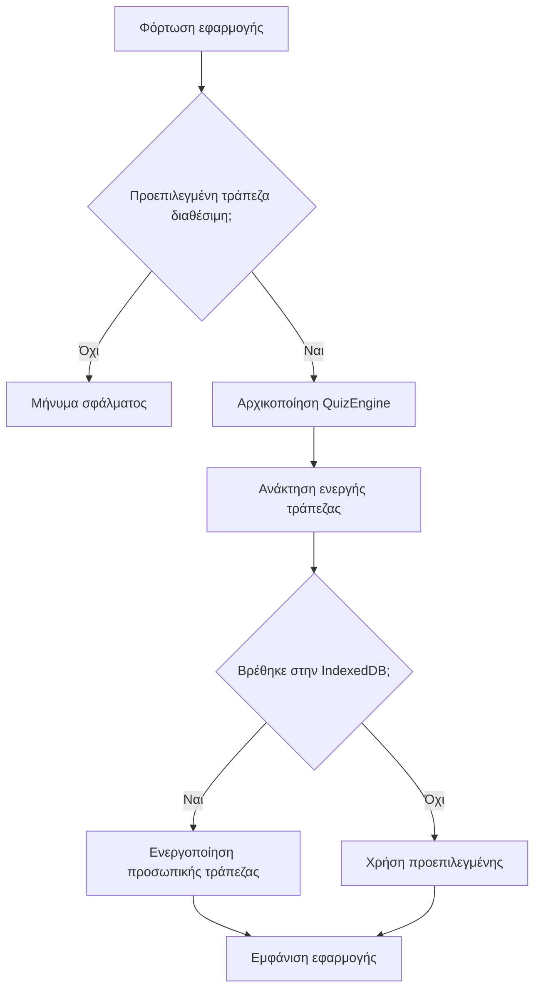
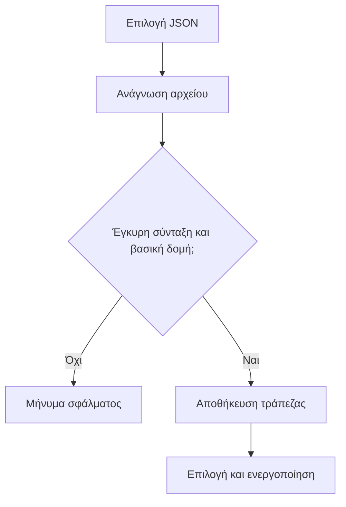
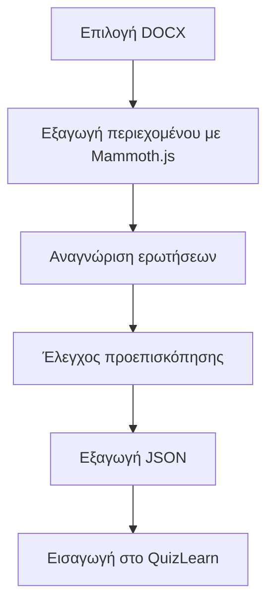

# QuizLearn v1.7 — Flowcharts

> Τεκμηρίωση βάσει του τεχνικού εγχειριδίου v1.7. Τα προτεινόμενα tests δεν έχουν πιστοποιηθεί ως εκτελεσμένα.

## 7. Διαγράμματα ροής

## 7.1 Εκκίνηση

| Έναρξη → φόρτωση HTML / scripts |
| --- |
| ↓ |
| Έλεγχος προεπιλεγμένων ερωτήσεων → αρχικοποίηση QuizEngine και UI |
| ↓ |
| Ανάγνωση αναγνωριστικού ενεργής τράπεζας |
| ↓ |
| Υπάρχει έγκυρη αποθηκευμένη τράπεζα; |
| ΝΑΙ → ανάκτηση ερωτήσεων / ΟΧΙ → διατήρηση προεπιλογής |
| ↓ |
| Εμφάνιση πίνακα επιλογών |

## 7.2 Εισαγωγή και ενεργοποίηση JSON

| Επιλογή αρχείου .json → ανάγνωση κειμένου → JSON.parse |
| --- |
| ↓ |
| Έλεγχος βασικής δομής και ενημέρωση χρήστη |
| ↓ |
| Επιλογή αποθήκευσης → συναλλαγή IndexedDB |
| ↓ |
| Επιλογή ενεργοποίησης → ενημέρωση ενεργής τράπεζας |
| ↓ |
| Ανανέωση περιβάλλοντος και διαθέσιμων ερωτήσεων |

## 7.3 Κύκλος ερώτησης

| Επιλογή λειτουργίας → φόρτωση ερωτήσεων |
| --- |
| ↓ |
| Εμφάνιση ερώτησης και εναλλακτικών απαντήσεων |
| ↓ |
| Απάντηση ή παράλειψη → ενημέρωση κατάστασης |
| ↓ |
| Υπάρχει επόμενη ερώτηση; ΝΑΙ → επανάληψη |
| ΟΧΙ → υπολογισμός σκορ και εμφάνιση αποτελεσμάτων |

## 7.4 Μετατροπή DOCX → JSON

| Επιλογή αρχείου DOCX → ανάγνωση με Mammoth.js |
| --- |
| ↓ |
| Εξαγωγή/ανάλυση περιεχομένου σύμφωνα με μορφότυπο μετατροπέα |
| ↓ |
| Εμφάνιση αποτελέσματος και πιθανών προειδοποιήσεων |
| ↓ |
| Εξαγωγή JSON → εισαγωγή στην εφαρμογή |
Σημείωση: Τα διαγράμματα είναι λειτουργικές απεικονίσεις. Για αυστηρή UML τεκμηρίωση μπορούν να μετατραπούν σε activity και sequence diagrams με ειδικό εργαλείο.

## Διαγράμματα Mermaid (προτεινόμενη οπτική αναπαράσταση)

### Εκκίνηση

### Εισαγωγή JSON

### Μετατροπή DOCX

