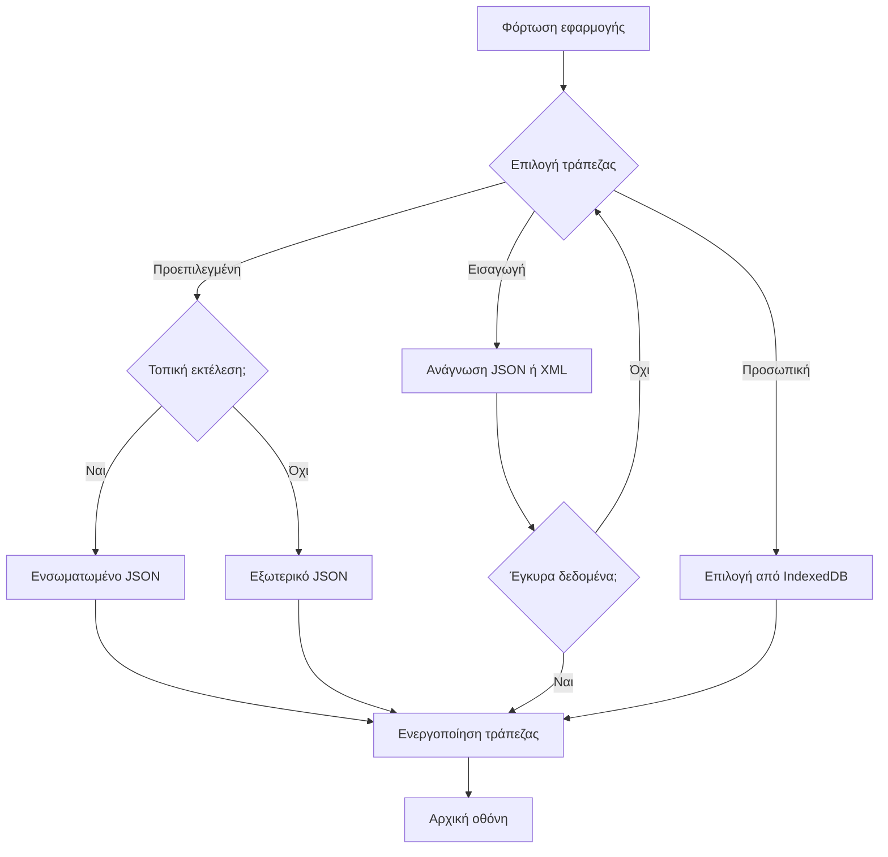
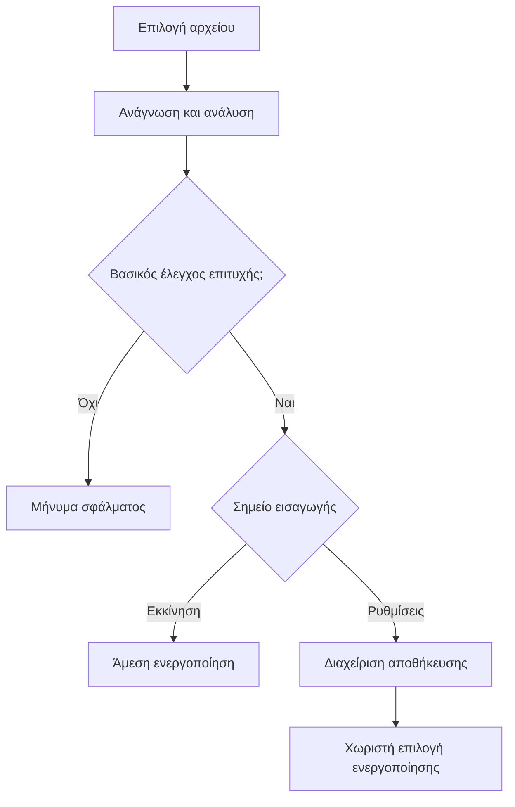
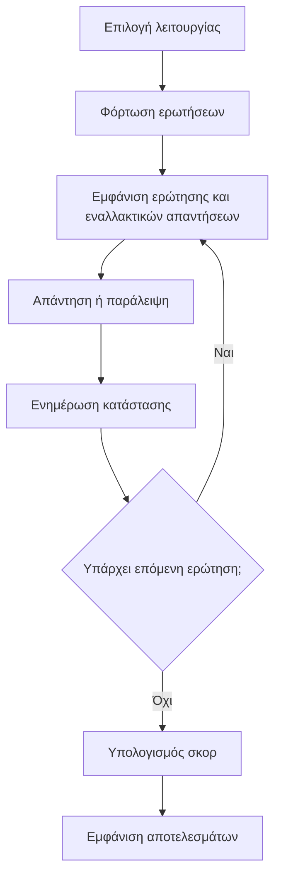
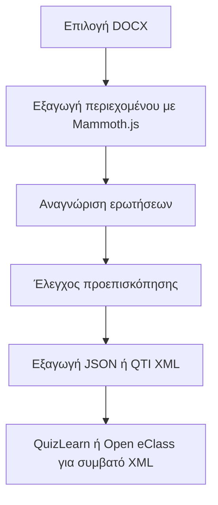

# QuizLearn v2.1.0 — Flowcharts

> Η επικαιροποίηση της 27/11/2026 βασίζεται στην προηγούμενη τεκμηρίωση και στις επιβεβαιωμένες λειτουργίες της v2.1.0, όχι σε νέα πλήρη επιθεώρηση του τελικού πηγαίου κώδικα. Οι δοκιμές της v1.7 διατηρούνται ως ιστορικά αποτελέσματα. Βλ. [testing-maintenance.md](testing-maintenance.md), ενότητες 13–14.

## 7. Διαγράμματα ροής

## 7.1 Εκκίνηση

| Βήμα | Ροή |
| --- | --- |
| 1 | Φόρτωση HTML και scripts |
| 2 | Παράθυρο επιλογής τράπεζας |
| 3α | Προεπιλεγμένη: εξωτερικό JSON στο Web ή ενσωματωμένο JSON μέσω file:// |
| 3β | Εισαγωγή JSON ή συμβατού XML και βασικός έλεγχος |
| 3γ | Επιλογή προσωπικής τράπεζας από IndexedDB |
| 4 | Ενεργοποίηση επιλεγμένης τράπεζας και εμφάνιση εφαρμογής |

## 7.2 Εισαγωγή και ενεργοποίηση JSON / XML

| Βήμα | Ροή |
| --- | --- |
| 1 | Ανάγνωση JSON ή συμβατού IMS QTI XML |
| 2 | Ανάλυση και βασικός έλεγχος δεδομένων |
| 3α | Κατά την εκκίνηση: άμεση ενεργοποίηση, χωρίς υποχρεωτική αποθήκευση |
| 3β | Μέσω Ρυθμίσεων: διαχείριση αποθήκευσης και χωριστή επιλογή ενεργοποίησης |
| 4 | Χρήση ενεργής τράπεζας |

## 7.3 Κύκλος ερώτησης

| Επιλογή λειτουργίας → φόρτωση ερωτήσεων |
| --- |
| ↓ |
| Εμφάνιση ερώτησης και εναλλακτικών απαντήσεων |
| ↓ |
| Απάντηση ή παράλειψη → ενημέρωση κατάστασης |
| ↓ |
| Υπάρχει επόμενη ερώτηση; ΝΑΙ → επανάληψη |
| ΟΧΙ → υπολογισμός σκορ και εμφάνιση αποτελεσμάτων |

## 7.4 Μετατροπή DOCX → JSON / IMS QTI XML

| Επιλογή αρχείου DOCX → ανάγνωση με Mammoth.js |
| --- |
| ↓ |
| Εξαγωγή/ανάλυση περιεχομένου σύμφωνα με μορφότυπο μετατροπέα |
| ↓ |
| Εμφάνιση αποτελέσματος και πιθανών προειδοποιήσεων |
| ↓ |
| Εξαγωγή JSON ή QTI XML → εισαγωγή στο QuizLearn ή συμβατού XML στο Open eClass |
Σημείωση: Τα διαγράμματα είναι λειτουργικές απεικονίσεις. Για αυστηρή UML τεκμηρίωση μπορούν να μετατραπούν σε activity και sequence diagrams με ειδικό εργαλείο.

## Διαγράμματα Mermaid (προτεινόμενη οπτική αναπαράσταση)

### Εκκίνηση

### Εισαγωγή JSON / XML

### Κύκλος ερώτησης

### Μετατροπή DOCX

